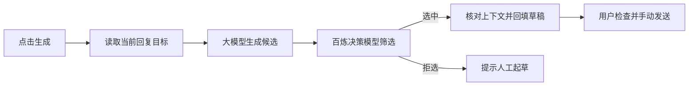

<div align="center">

# X 快速回复

**读取当前对话，大模型起草，百炼决策，检查后发送。**


[](LICENSE)

[核心功能](#核心功能) · [快速开始](#快速开始) · [模型配置](#模型配置) · [使用说明](#使用说明) · [常见问题](#常见问题) · [开发与验证](#开发与验证)

</div>

## 项目概述

X 快速回复是一款用于 X（原 Twitter）的 Chrome 插件。打开帖子回复弹窗或私信会话后，点击生成按钮，即可根据当前内容起草多条回复，由阿里云百炼决策模型选择合适的一条，再回填到输入框。

生成模型支持自定义 OpenAI 兼容接口；回复风格可在插件设置中编辑，默认以自然、像真人随手回复为优先，幽默只在语境自然时使用。最终内容由你检查并手动发送。

> 当前为 **0.4.0 开发预览版**。自动化测试已验证发送后自动点赞的开关与状态确认；真实 Chrome/X 页面的读取、回填、发送和点赞仍待完整验收，回复质量也需人工检查。

## 核心功能

- **按当前语境起草**：读取当前帖子回复弹窗中的目标正文，或当前私信会话中的可见消息。
- **生成与决策分工**：生成模型提供 2–5 条候选，百炼决策模型从中选择，也可以拒选。
- **跟随正文语言**：依据目标内容生成对应语言的回复；中文帖子回复中文，英文帖子回复英文。
- **自定义整体提示词**：设置口吻、接话方式和禁用表达，生成与决策共用同一份偏好。
- **学习个人口吻**：可填写 3–10 条自己的历史回复示例，只学习表达习惯，不复制其中事实。
- **草稿保护**：初始已有草稿时停止；成功回填后，可切换候选替换尚未手动修改的插件草稿。
- **发送后打开原帖并点赞**：公开回复可在设置中开启；用户实际发送并得到页面确认后，插件使用弹窗捕获的原帖状态 URL 打开原帖，在该帖子页面对未点赞按钮执行一次点击。
- **上下文变化检查**：切换会话、修改正文或草稿、编辑器变化后，停止旧结果回填。
- **明确报告失败**：配置缺失、请求失败、输出无效或回填校验失败时停止，不自动重试、切换模型或使用替代答案。

## 工作流程



两阶段请求均经本地 Python 网关调用配置的模型服务。插件只负责读取当前目标、展示候选和回填草稿；发送仍由用户手动完成，开启自动点赞后会在确认发送后打开原帖并处理点赞。

## 技术栈

| 组件 | 技术与用途 |
| --- | --- |
| 浏览器插件 | Chrome Manifest V3、React 17 UI、原生 DOM 集成、HTML、CSS |
| 本地网关 | Python 3.10+，仅使用标准库，监听 `127.0.0.1` |
| 回复生成 | 可配置的 OpenAI 兼容聊天接口 |
| 回复决策 | 阿里云百炼 `decision-model-preview` |
| 自动化测试 | Node.js 测试运行器、jsdom、React、Draft.js、Python unittest |

插件与网关运行无需 Node.js、数据库或前端构建；React 运行时随扩展以本地文件提供。Node.js 仅用于开发测试。

## 快速开始

### 1. 准备环境

- 已安装 Chrome，并登录 X。
- 已安装 Python 3.10 或更高版本。
- 已准备生成服务的接口地址、模型名称和密钥。
- 已开通阿里云百炼决策模型权限，并准备对应的地址和凭据。

### 2. 获取代码并填写配置

在 PowerShell 中执行：

```powershell
git clone https://github.com/xForMe/x-quick-reply.git
cd x-quick-reply
Copy-Item .env.example .env
```

**已有 `.env` 时跳过复制，避免覆盖现有配置。** 编辑仓库根目录的 `.env`，填写[模型配置](#模型配置)中的生成与决策参数。

`.env` 已被根目录的 `.gitignore` 排除；仓库只提供不含凭据的配置示例。

### 3. 启动本地网关

在仓库根目录执行：

```powershell
python gateway.py
```

终端显示监听地址 `http://127.0.0.1:8787` 后，保持窗口运行。按 `Ctrl+C` 停止服务。

服务启动只表示网关已监听，不代表模型接口已经调用成功。首次生成时仍会检查配置与模型响应。同一端口只运行一个网关实例。

### 4. 加载 Chrome 插件

1. 在 Chrome 地址栏输入 `chrome://extensions`。
2. 打开右上角的“开发者模式”。
3. 点击“加载已解压的扩展程序”。
4. 选择克隆目录内的 **`extension` 子目录**。
5. 确认插件名称为“X 快速回复（预览）”，版本为 **0.4.0**。

只加载 `extension`，不要选择包含 `gateway.py` 和 `.env` 的仓库根目录。

### 5. 保存设置并开始使用

点击工具栏插件图标 →“扩展设置”，确认网关地址为 `http://127.0.0.1:8787`，设置语气、候选数量、整体回复提示词、可选的“我的回复示例”，以及是否“发送公开回复后打开原帖并自动点赞”，然后保存。

回到 X，刷新页面，从原帖回复按钮打开回复弹窗，保持输入框为空，点击面板中的“生成并填入回复”。检查回填内容后，手动发送；若已开启自动点赞，插件会在确认发送后打开捕获到的原帖并尝试点赞，失败会明确提示且不重试。

## 模型配置

配置文件位于仓库根目录 `.env`，完整模板见 [.env.example](.env.example)。进程环境变量优先于文件中的同名配置，修改后需重启网关。

### 生成模型

| 配置项 | 必填 | 说明 |
| --- | --- | --- |
| `LLM_BASE_URL` | 是 | OpenAI 兼容接口基础地址，包含服务要求的版本路径，如 `/v1`，不含 `/chat/completions` |
| `LLM_MODEL` | 是 | 该接口实际支持的模型名称 |
| `LLM_API_KEY` | 是 | 生成服务密钥 |
| `LLM_JSON_MODE` | 否 | 默认 `false`；服务明确支持 `response_format=json_object` 时可设为 `true` |

生成模型须按要求返回完整、有效的 JSON。关闭 `LLM_JSON_MODE` 只是不发送该接口参数，程序仍会严格校验响应格式。

开发期间曾通过配置的兼容服务调用 `gpt-6-luna`，相关记录见[提示词样本验证](doc/提示词样本验证.md)。这不代表所有服务都提供同名模型，请以你的服务实际支持情况为准。

### 百炼决策模型

决策模型固定为 `decision-model-preview`，支持以下两种凭据方式：

| 配置项 | 普通百炼 | 百炼 Token Plan 套餐 |
| --- | --- | --- |
| `DECISION_PROVIDER` | `bailian` | `bailian-token-plan` |
| `BAILIAN_SYSTEMONE_URL` | 必填，完整决策接口地址 | 无需填写，程序使用固定官方地址 |
| `DASHSCOPE_API_KEY` | 必填 | 不使用 |
| `BAILIAN_TOKEN_PLAN_API_KEY` | 不使用 | 必填，使用套餐专用密钥 |

普通百炼地址格式如下；业务空间与地域须使用你实际开通的信息。当前代码接受北京和新加坡地域的对应官方地址。

```text
https://<业务空间ID>.<地域>.maas.aliyuncs.com/compatible-mode/v1/systemone
```

例如地域字段为 `cn-beijing` 或 `ap-southeast-1`。普通百炼密钥与套餐专用密钥不可混用。

### 本地运行参数

| 配置项 | 默认值 | 说明 |
| --- | --- | --- |
| `MODEL_TIMEOUT_SECONDS` | `25` | 每次上游模型请求的超时秒数，范围 1–90 |
| `QUICK_REPLY_PORT` | `8787` | 本地网关端口，范围 1024–65535；修改后同步更新插件设置 |

生成与决策顺序执行，总耗时包括两次模型请求及页面校验；实际速度取决于服务、模型和上下文长度。

## 使用说明

### 回复帖子

1. 打开原帖详情页，点击该帖的回复按钮。
2. 确认弹窗同时显示目标帖正文和回复输入框。
3. 保持输入框为空，点击“生成并填入回复”。
4. 等待候选生成和决策完成，检查输入框中的草稿。
5. 如需其他候选，选中后点击“回填输入框”；确认后手动发送。

开启“发送公开回复后打开原帖并自动点赞”时，插件会等待 X 清空或卸载回复编辑器，读取弹窗内可靠的原帖状态 URL，打开原帖页面，对未点赞按钮点击一次并核对已点赞状态。没有可靠状态 URL 时停止；私信不触发；发送或点赞状态无法确认时停止并提示，不自动发送或重试。

成功回填后，只能替换尚未手动修改的插件草稿。重复回填同一候选不会追加；手动修改后再次回填会停止并保留你的内容。

### 回复私信

打开具体私信会话后，使用相同的生成与回填流程。支持的会话路径形如 `/messages/<会话ID>` 或 `/i/chat/<会话ID>`。插件处理最近最多 20 条可见消息，每条最多读取 800 字符，总计不超过 8,000 字符；未加载或未进入读取范围的消息不会作为上下文。

### 自定义回复风格

在“扩展设置”中编辑“整体回复提示词”，可填写 1–3000 字符。例如：

```text
像日常聊天一样接话，轻松、有一点幽默，优先一句，最多两句。
抓住原帖的具体细节，不要复述后再夸一句，不套用万能鼓励。
不熟装熟，不假装自己有相同经历，不为搞笑编造事实。
严肃或难过的话题认真回应，没有自然的笑点就正常说话。
```

保存后，下次生成生效，无需重启网关。“恢复默认提示词”只修改设置页文本，仍需点击保存。可填写 3–10 条你自己写过的回复作为口吻参考，最多 3000 字符；示例会发送给两个模型，不要放入敏感内容。

整体提示词用于表达个人偏好，生成与决策共用；共同事实和质量约束见[回复规则](prompts/reply-policy.md)。提示词中使用中文不代表强制中文回复，实际回复语言跟随目标正文。

### 当前支持范围

| 场景 | 支持情况 |
| --- | --- |
| 唯一帖子回复弹窗，目标正文与输入框可识别 | 支持；目标正文须非空且不超过 800 字符，公开回复不超过 280 字符 |
| 已打开的具体私信会话 | 支持；须能确定当前会话边界 |
| 帖子详情页的内联回复框 | 暂不支持，需点击原帖回复按钮打开弹窗 |
| 普通发帖、引用帖、多回复目标、纯图片或多正文目标 | 当前不支持，会停止并报错 |
| 图片理解、隐藏消息、完整历史会话、其他聊天网站 | 当前不支持 |

生成期间请保持当前目标和草稿不变。百炼拒选时会提示人工起草；“选择置信度”是模型输出，不能当作回复正确率。

## 更新与停用

- **更新插件**：保存需要保留的草稿，在 `chrome://extensions` 重新加载插件，再刷新 X 并重新打开回复弹窗。
- **更新网关、共同规则或模型配置**：停止旧网关，再运行 `python gateway.py`。
- **升级到 0.4.0**：网关与扩展一起更新；本版使用 `quick-reply.v2`，与旧版协议不兼容。自动点赞默认关闭，需在扩展设置中明确开启；确认发送后会打开原帖再点赞，仍由用户手动发送回复。
- **停用**：在扩展管理页关闭插件，并停止网关。已有草稿由你自行处理。

## 隐私与凭据

- 模型密钥保存在本地网关配置中，不能填写到插件提示词或提交到仓库。
- 生成与决策服务都会接收所选上下文、整体提示词和你填写的回复示例；本地网关不等于本地模型推理。
- 网关不保存聊天正文或请求日志；模型服务的数据处理方式取决于对应服务商。
- 自定义提示词保存在 Chrome 本地扩展设置中，避免填写密钥或敏感个人资料。
- 网关仅监听 `127.0.0.1`，适用于可信的单用户设备；其来源校验不能隔离同机其他进程或扩展，不应部署到公网。

## 常见问题

| 问题 | 处理方法 |
| --- | --- |
| 加载时报 `__pycache__` 名称保留 | 重新选择仓库内的 `extension` 子目录加载 |
| 页面没有快速回复面板 | 刷新 X，打开有效回复弹窗或具体私信；也可点插件图标 →“打开快速回复面板” |
| 提示插件连接已失效 | 刷新的是 **X 网页**；只重新加载扩展不足以更新页面内的旧脚本 |
| 提示“请打开唯一的帖子回复弹窗” | 从原帖回复按钮打开弹窗，确认只有一个可见回复框；详情页内联回复暂不支持 |
| 提示“仅允许当前 X 会话调用” | 确认插件为当前版本，刷新 X 并打开有效回复场景；仍失败时保留完整提示 |
| 网关连接失败或端口被占用 | 检查网关终端、端口设置和旧进程；同一端口只保留一个实例 |
| 提示缺少配置项 | 填写 `.env` 中对应字段，再重启网关；检查同名进程环境变量是否覆盖配置 |
| 模型接口返回 401 或 403 | 核对失败服务的密钥、模型权限与业务空间；区分普通百炼与套餐凭据 |
| 模型接口返回 402 或 429 | 核对额度和限流；本次请求已停止，不会自动重试 |
| 候选 JSON 无效、被截断或回复语言不符 | 保留完整错误，检查服务与模型输出；无效结果不会进入后续回填 |
| 协议版本或整体提示词无效 | 同步更新扩展与网关，并在扩展设置中保存有效提示词 |
| 提示会话或草稿已变化 | 检查当前会话与草稿，再重新生成；已有手动修改会被保留 |
| 编辑器未接收粘贴或回填核验失败 | 停止操作并保留完整错误；程序不会重试写入或自动删除内容 |
| 百炼没有选中回复 | 人工起草；程序不会用固定文案代替结果 |

读取仍失败时，可点击面板中的“复制排查信息”。该诊断只包含节点类型、层级和计数等结构元数据，不包含正文、草稿、帖子标识、网址或凭据。反馈入口：[提交问题](https://github.com/xForMe/x-quick-reply/issues)。

## 项目结构

```text
x-quick-reply/
├── extension/                 # Chrome 插件，加载此目录
│   ├── manifest.json          # 插件声明与权限
│   └── src/                   # React 面板、页面脚本、后台、设置页与本地运行时
├── gateway.py                 # 本地模型网关
├── prompts/
│   └── reply-policy.md        # 生成与决策共用的回复规则
├── tests/                     # 自动化测试与真实模型样本验证工具
├── doc/                       # 需求、技术、部署与测试记录
├── .env.example               # 脱敏配置模板
├── .gitignore                 # 排除本地配置、依赖和缓存
├── AGENTS.md                  # 项目协作与失败处理约定
├── package.json               # 开发测试依赖与命令
├── package-lock.json          # 开发依赖锁定文件
├── readMe.md                  # 中文使用说明
└── LICENSE                    # Apache 2.0 许可证
```

## 开发与验证

推荐使用 Node.js 24 进行开发测试；Python 要求为 3.10+。在仓库根目录执行：

```powershell
npm ci
npm test
python -X utf8 -m unittest discover -s tests -v
```

截至 2026-10-18，已有 **70 项前端和 26 项后端自动化测试通过**，覆盖上下文边界、草稿保护、候选替换、语言约束、模型契约、发送后打开原帖点赞及失败停止等行为。自动点赞测试还覆盖 `tweetButtonInline`、状态链接重写、带数量的点赞 aria 标签、发送后路由切换、首页弹窗、跨页面任务恢复和损坏任务清理。测试中使用了明确标记的页面与请求替身，不能替代真实 Chrome/X 验收。

需要验证实际模型时，先填写本地配置，再手动执行：

```powershell
python -X utf8 tests/evaluate_prompts.py
```

该命令会真实调用配置的生成与决策服务，可能产生费用，并记录合成样本的模型输出；首次失败即停止，不自动重试。有限样本不能证明整体回复质量、持续延迟或事实准确率。

## 详细文档

| 文档 | 内容 |
| --- | --- |
| [需求说明](doc/需求.md) | 目标、使用场景、功能边界与验收标准 |
| [技术方案](doc/技术.md) | 扩展结构、接口契约、上下文与回填校验 |
| [部署说明](doc/部署.md) | 环境、配置、升级与停用步骤 |
| [测试记录](doc/测试.md) | 回归测试、历史问题与验证边界 |
| [提示词样本验证](doc/提示词样本验证.md) | 合成样本的真实模型调用与质量观察 |

## 许可证

本项目采用 [Apache 2.0 许可证](LICENSE)。
